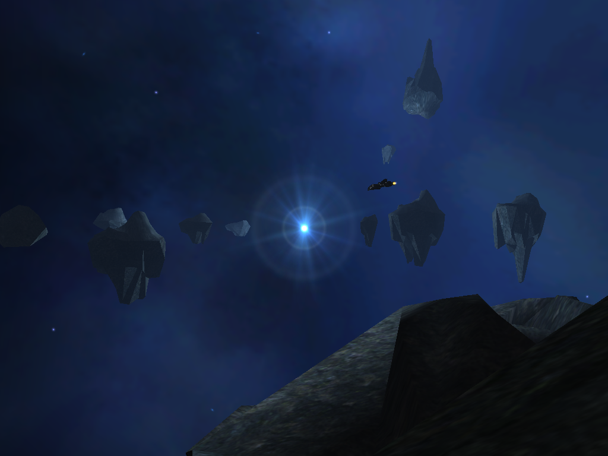
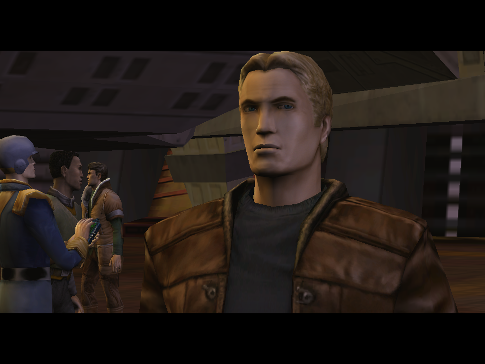
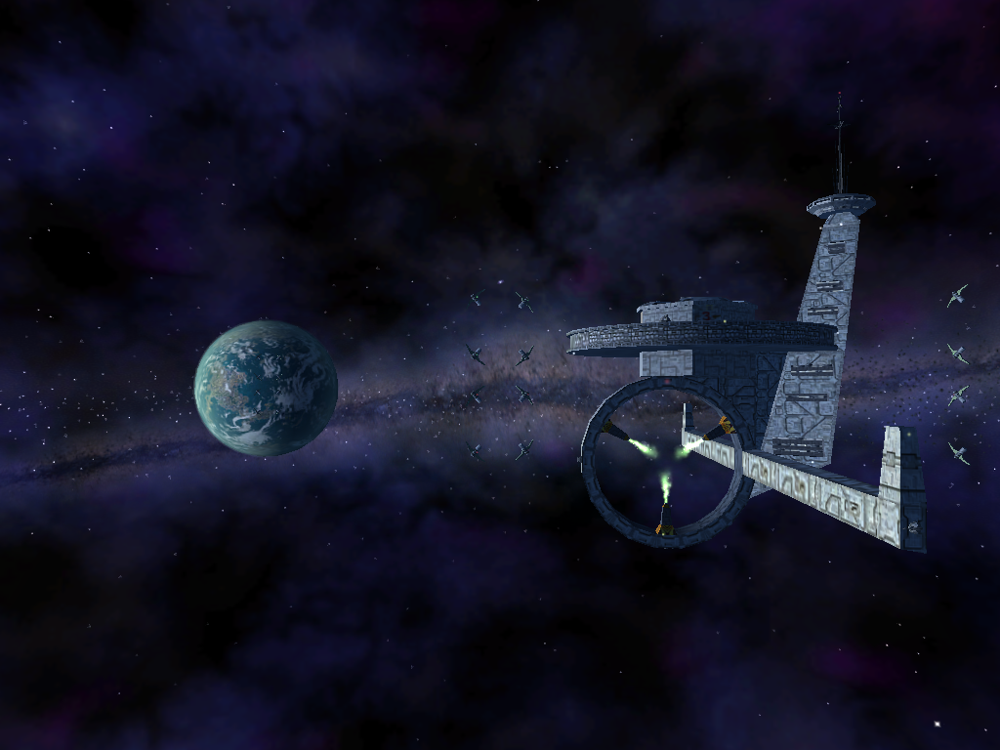
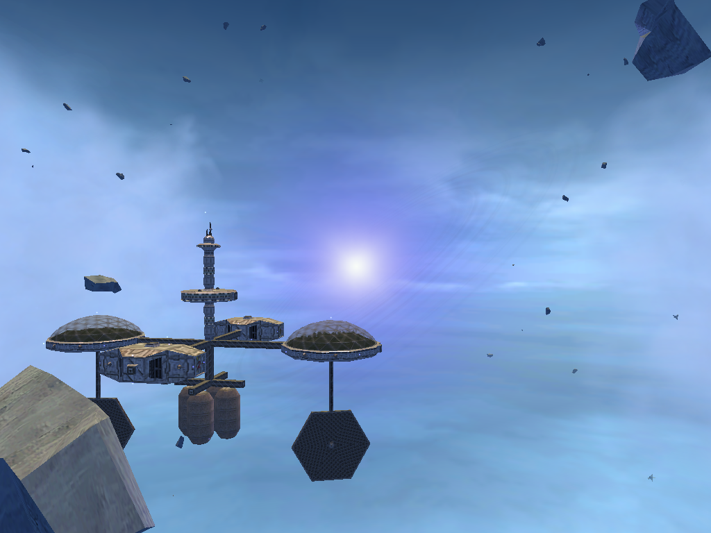
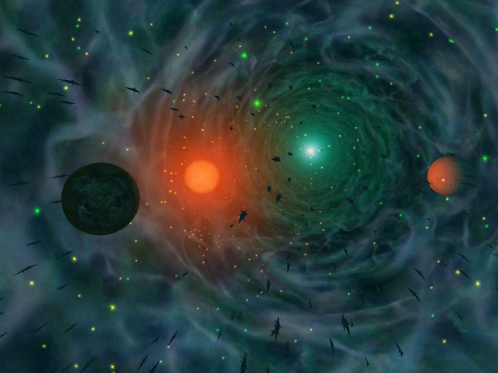
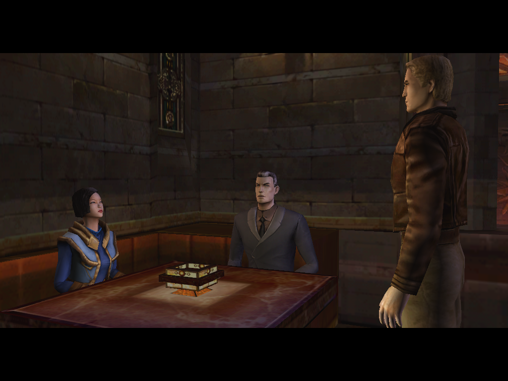

# @treewyrm/freelancer-webgl2

TypeScript library rendering **Freelancer** (Digital Anvil, 2003) through WebGL2. It aims for the
picture the game draws, checked against frames captured from the retail game. Built on
[`@treewyrm/freelancer`](https://www.npmjs.com/package/@treewyrm/freelancer), which reads the game's
formats, and written first for `freelancer-vscode`, the Freelancer extension for VS Code.

Not affiliated with or endorsed by Digital Anvil or Microsoft. No game data ships in this package:
the host supplies the bytes of its own install.

## Screenshots

Frames drawn by this library from a retail install, at the game's 1024×768.

| | |
| --- | --- |
|  |  |
| Main menu, `intro_planetchunks.thn` | Opening cutscene on Manhattan, `s002xe` at 0:20.8 |
|  |  |
| Fort Bush, New York (LI01) | Freeport 10, Tau-37 (EW01) |
|  |  |
| Unknown System (EW06) | Juni and the diplomat in Manhattan's bar, `s004x` at 0:20.5 |

## Status

These render and match retail:

- **Models**: rigid models with every registered material type, level of detail, UV animation,
  environment maps, cloaking and Nomad surfaces. The canopy glass's picture is still open; see
  [VALIDATION.md](docs/VALIDATION.md#open-questions).
- **Characters**: skinned bodies, heads and hands, posed by animation.
- **Planets, starspheres and backdrops.**
- **Alchemy effects**: particles, beams, and their fields.
- **Whole systems**, framed as the game frames space: suns with their coronas and flares, nebulae,
  asteroid fields, rings, space dust, effects, running lights, laser shots and tractor beams.
- **Base rooms** with their lights and shadows.
- **Cutscenes**: THN playback, its clock, cameras, lights and paths.

The extension's model viewer, character editor, material preview, effect editor, system editor,
Loadouts and Beams editors draw with it; its own renderer is down to the camera, the pick and the
overlays.

Not drawn yet: the HUD and 2D interface. Wanted beyond retail, as an option: keeping a Targa's 24
bits, where retail narrows it to 16 and bands a starsphere.

## Use

The host reads the bytes with `@treewyrm/freelancer`, describes a scene as plain data, and collects a
frame from it. Collecting touches no GL: a frame is an ordered list of draws, which the renderer then
executes.

```ts
import {
  collectFrame,
  createContext,
  createRenderer,
  placeParts,
  type Scene,
} from '@treewyrm/freelancer-webgl2'
import { getMaterial, readMaterialLibrary } from '@treewyrm/freelancer/material'
import { Matrix3, Matrix4 } from '@treewyrm/freelancer/math'
import { readRigidModel } from '@treewyrm/freelancer/rigid'
import { readTextureLibrary } from '@treewyrm/freelancer/texture'
import { Directory } from '@treewyrm/freelancer/utf'
import { getMesh, readVMeshLibrary } from '@treewyrm/freelancer/vmesh'

// A .cmp that carries its own meshes, materials and textures.
const root = Directory.read(bytes)
const meshes = readVMeshLibrary(root)
const materials = [...readMaterialLibrary(root)]
const textures = [...readTextureLibrary(root)]

const scene: Scene = {
  camera: {
    position: { x: 0, y: 0, z: 50 },
    orientation: Matrix3.identity,
    fovh: 35,
    near: 1,
    far: 10000,
  },
  aspect: canvas.width / canvas.height,
  ambient: { x: 0.2, y: 0.2, z: 0.2 },
  lights: [{ color: { x: 1, y: 1, z: 1 }, direction: { x: 0, y: -1, z: -1 } }],
  models: [
    {
      parts: placeParts(readRigidModel(root), Matrix4.identity),
      mesh: (id) => getMesh(meshes, id),
      material: (id) => getMaterial(materials, id),
      texture: (name) => textures.find((entry) => entry.name.toLowerCase() === name.toLowerCase()),
    },
  ],
}

const renderer = createRenderer(createContext(canvas))
renderer.render(collectFrame(scene))
```

Each kind of picture has its own collector, since each orders, lights and fogs differently:

| Collector           | Draws                                                          |
| ------------------- | -------------------------------------------------------------- |
| `collectFrame`      | A preview: models and effects, under lights the host chooses   |
| `collectSpaceFrame` | A system as the game frames space, from a `SpaceScene`         |
| `collectRoomFrame`  | A base room, with its lights, flashlights and shadows          |

`thorn` plays THN scripts: their clock, events, placement and paths. It draws nothing itself; a room
or space frame draws what it places.

**The host owns** the canvas, scheduling, file loading and time. Nothing reads a clock,
a filesystem or a network, and nothing needs a DOM beyond the canvas or context handed in, so it
runs in a worker. What rolls dice takes the host's `random`, falling back to `Math.random` when
none is given. GPU resources are cached on object identity, so pass raw objects,
not reactive proxies.

**Editor visuals** draw through hooks: `renderer.render(frame, { begin, opaque, end })`. A hook gets
the depth buffer the game left and the view-projection, and may change any GL state; the renderer
sets its own back afterwards. A hook that draws nothing leaves the frame pixel for pixel as it was.

**What retail hardcodes is a default**, where a mod can patch it: `RETAIL_SPACE_LIMITS`,
`RETAIL_POOLS`, `RETAIL_DUST_LIMITS` and the other `RETAIL_*` exports. Pass your own to match a mod.

It needs WebGL2, and `WEBGL_compressed_texture_s3tc` for DXT textures.

Every export, by area, with recipes for effects, systems and rooms, is in [docs/API.md](docs/API.md).

## Develop

```sh
npm install
npx playwright install chromium   # once, for the GPU tests
npm test                          # pure tests in Node
npm run test:gpu                  # headless Chromium on the hardware GPU, never software
npm run typecheck
npm run build
```

Tests that read retail assets look in `$FREELANCER_DATA`, then `~/Downloads/Freelancer/DATA`, and
skip when neither is there. `npm run view`, `capture`, `reference` and `bench` work against a retail
install; [CLAUDE.md](CLAUDE.md) lists them.

| Doc                                        | Covers                                                    |
| ------------------------------------------ | --------------------------------------------------------- |
| [CLAUDE.md](CLAUDE.md)                     | Sources in order of authority, rules, layout, code style |
| [docs/API.md](docs/API.md)                 | What's what, every export by area, and recipes            |
| [docs/ARCHITECTURE.md](docs/ARCHITECTURE.md) | The frame as data, materials, the host boundary, hooks  |
| [docs/VALIDATION.md](docs/VALIDATION.md)   | Checking against retail: reference scenes and captures    |
| [docs/COVERAGE.md](docs/COVERAGE.md)       | Each material's status, by evidence                       |
| [docs/retail/](docs/retail/README.md)      | How retail renders, where it isn't obvious, each claim checked or marked |
| [docs/DECOMP-ERRORS.md](docs/DECOMP-ERRORS.md) | Where the decomp disagrees with the retail binary     |
